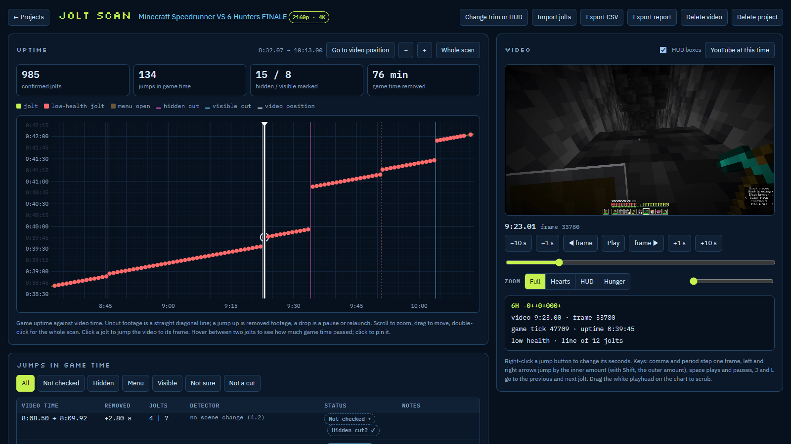
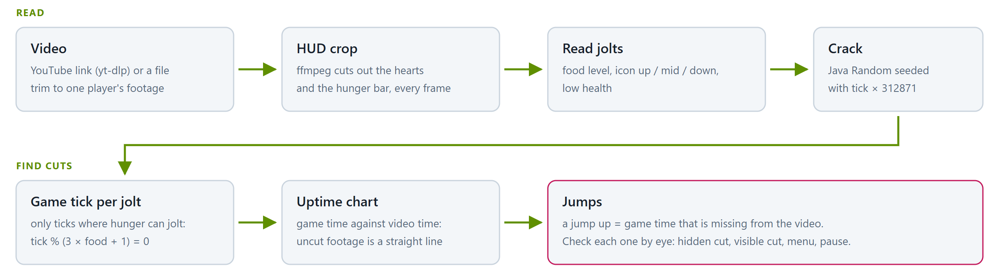
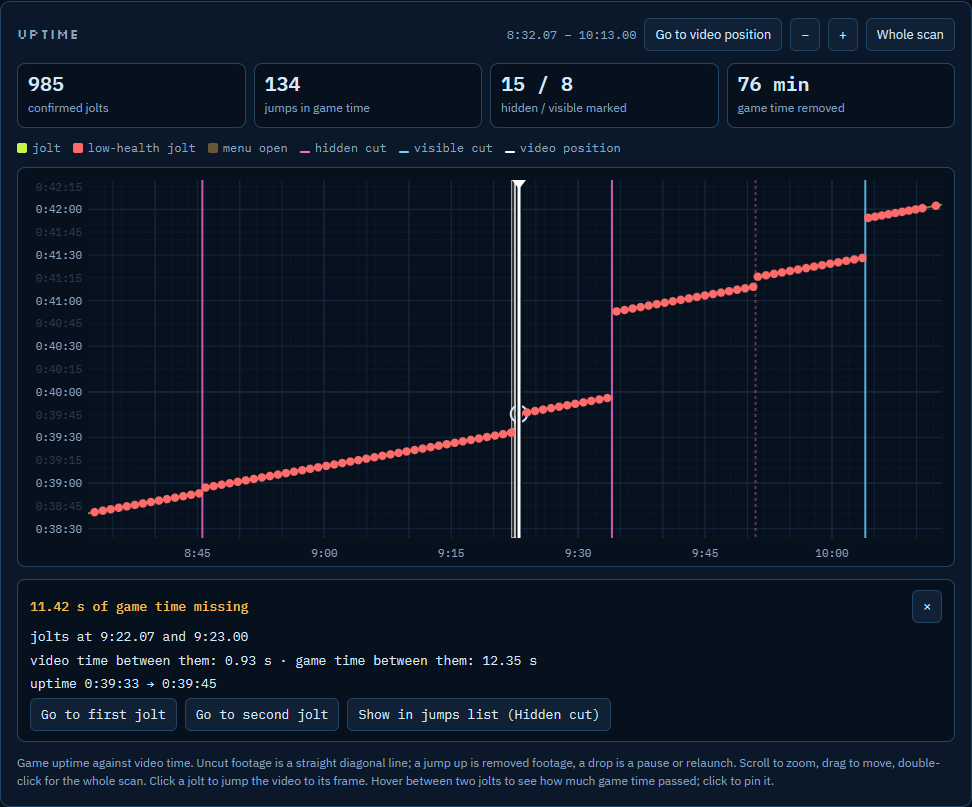
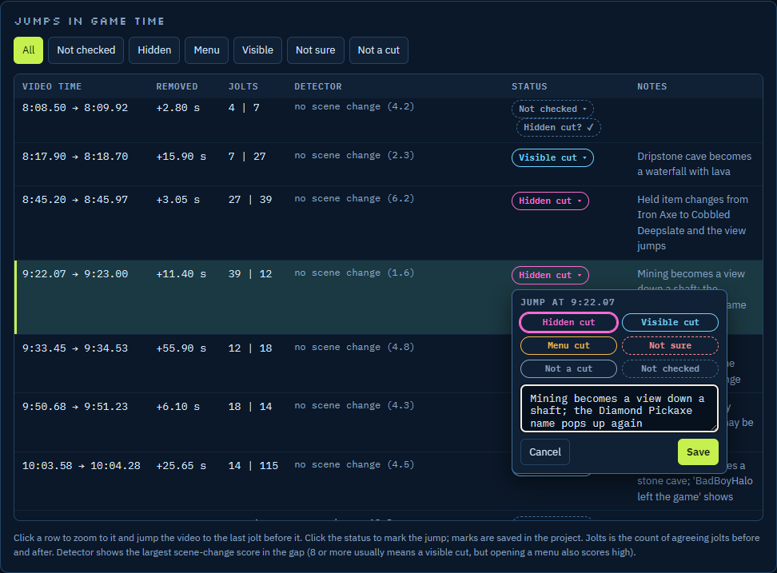
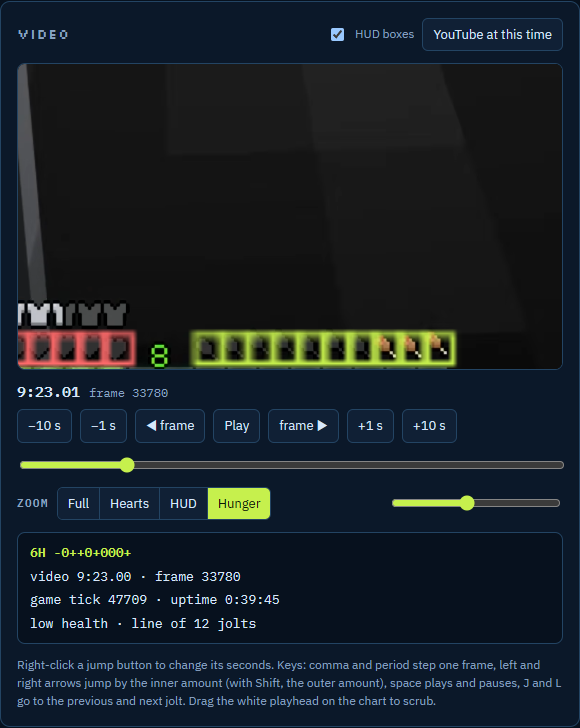
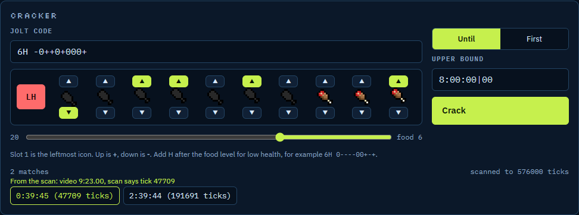
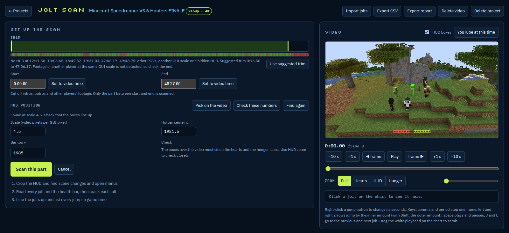
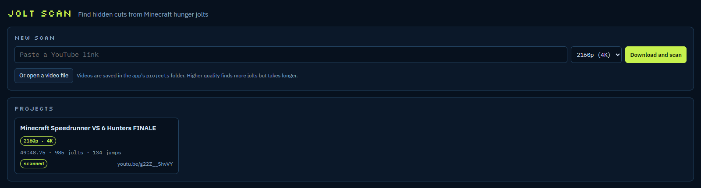

# Jolt Scan

<p align="center">
  <a href="../../stargazers"></a>
  <a href="../../releases"></a>
  <a href="../../releases/latest"></a>
  <a href="LICENSE.md"></a>
  
</p>

**Find hidden cuts in Minecraft videos.** Jolt Scan is an unofficial, local Windows app. It reads the hunger bar shake
("jolt") in every frame, cracks the game tick from it, and plots game uptime against video time. Uncut footage is a
straight line. A jump up means game time is missing from the video.

It is made for:

- speedrun and manhunt videos where you want to check for splices
- long uploads where cuts hide in menus, inventories and crafting tables
- checking a jump by eye at the exact frame, with the HUD boxes over the video

**What's new:** [CHANGELOG.md](CHANGELOG.md) (newest version first) · **Download:** [latest release](../../releases/latest)



<picture>
  <source media="(prefers-color-scheme: dark)" srcset="docs/images/flow-dark.png">
  
</picture>

## Screenshots

|  |  |
|---|---|
| **Uptime chart:** click between two jolts to pin the gap and see how much game time is missing. | **Jumps list:** every jump in game time. Click the status to mark it and add a note. |
|  |  |
| **Video panel:** frame-exact, with HUD boxes and zoom on the hearts, HUD or hunger bar. | **Cracker:** the jolt code of the selected jolt, cracked like the Jolt Cracker site. |
|  |  |
| **Set up the scan:** trim, a strip that shows where the HUD is visible, and the HUD position. | **Projects:** paste a YouTube link or open a file. Each scan is saved as a project. |

## Features

- **Paste a link, get a chart.** Paste a YouTube link (downloaded with yt-dlp, up to 4K) or open a video file. The app
  finds the HUD, crops it, scans every frame and cracks every jolt.
- **Finds the HUD by itself.** It finds the GUI scale and position, checks it over the whole video and suggests a trim
  where the HUD is missing (other players' footage, menus, end screens).
- **Low health and menus.** Reads the hearts too, so low-health jolts crack correctly. Jolts under menu dimming are
  read as well.
- **Diagonal uptime chart** like the Jolt Cracker site: smooth zoom, faded grid, gap highlights, and a draggable
  playhead that scrubs the video.
- **Click to check.** Click a jolt or a gap and the video jumps to that frame and the jumps list scrolls to the row.
- **Mark every jump:** hidden cut, visible cut, menu cut, not sure or not a cut, with a note. Marks are saved in the
  project.
- **Export** the results as CSV or as an HTML report.
- **Java-exact cracker.** `nextInt(3)` rerolls a draw that overflows a 32-bit int, the same as Minecraft. A self-test
  checks this before every build is used.
- **Scanner updates.** Checks Tick Studio on GitLab for changed files. Installs only after a test build and self-test
  pass. Works offline.
- **Local only.** The server listens on 127.0.0.1 only. Videos and scans stay in the `projects` folder. No telemetry.

## Requirements

- Windows 10 or 11
- [Python 3](https://www.python.org/) (tested with 3.13 and 3.14)
- [Rust](https://rustup.rs/), to build the scanner
- [FFmpeg](https://ffmpeg.org/) (ffmpeg and ffprobe) and [yt-dlp](https://github.com/yt-dlp/yt-dlp)

```bash
winget install Python.Python.3.13 Rustlang.Rustup Gyan.FFmpeg yt-dlp.yt-dlp
```

## Start

1. Download the zip from [Releases](../../releases/latest) and unzip it, or clone the repo.
2. Run `Jolt Scan.bat`. The first time, it downloads the Tick Studio files the scanner needs (pinned to one commit and
   checked by hash), builds the scanner and runs its self-test.
3. The app opens in your browser. Paste a YouTube link or open a video file.

To set up the scanner again by hand:

```bash
python app/setup_scanner.py
```

## How it works

Minecraft shakes the hunger icons when saturation is 0, on ticks where `tick % (3 × food + 1) == 0`. Each icon's
offset comes from Java Random seeded with `tick × 312871`. At low health the hearts roll first. So one jolt pattern
fits only a few ticks, and the run of jolts across a video gives game uptime frame by frame. The GUI tick counts from
game launch and never resets, so a jump up in the line means footage was removed.

## Star history

**If Jolt Scan helps you, please give it a star.** It is free and takes one click. Stars show me that people are
using it, help others find it, and keep me motivated to fix problems and add new features.

<a href="https://www.star-history.com/#KillerKingSolo/jolt-scan&Date">
 <picture>
   <source media="(prefers-color-scheme: dark)" srcset="https://api.star-history.com/svg?repos=KillerKingSolo/jolt-scan&type=Date&theme=dark" />
   <source media="(prefers-color-scheme: light)" srcset="https://api.star-history.com/svg?repos=KillerKingSolo/jolt-scan&type=Date" />
   
 </picture>
</a>

## Credits

- [Jolt Cracker](https://dartjs.com/joltcracker): the jolt cracking method and the site that the chart and cracker in
  this app are modeled on.
- [Tick Studio](https://gitlab.com/fanda8571/tick_studio): the Java Random port, the hunger icon matcher and the hunger
  textures used by the scanner. These files are downloaded at setup and are not stored here.
- [I Found a Bug in the Dream Investigation](https://youtu.be/B3AUMY5IVLo): explains the `nextInt` overflow case that
  the scanner handles.

## Disclaimer

Jolt Scan is an unofficial fan project. It is not affiliated with or endorsed by the Jolt Cracker site or its authors,
Tick Studio, Mojang Studios or Microsoft. Minecraft is a trademark of Microsoft and Mojang. A jump in the chart is
evidence to check by eye, not proof by itself.

## License

[PolyForm Noncommercial 1.0.0](LICENSE.md). You can use, change and share the code for noncommercial purposes. You
cannot sell it or use it commercially. The license does not cover the Tick Studio files or the Minecraft textures.
